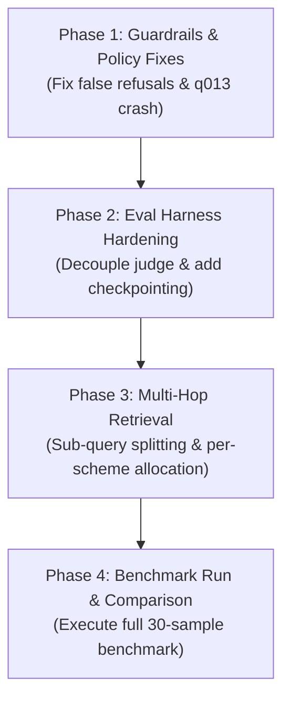

# 05 - Step-by-Step Implementation & Verification Plan

This document outlines the phased, step-by-step roadmap to resolve all identified issues, verify improvements with regression tests, and execute a new benchmark evaluation to compare against the baseline.

---

## Phase Overview



---

## Phase 1: Guardrails & Policy Refactoring

**Primary Goal:** Eliminate false guardrail refusals and prevent pipeline crashes on sentence limits.

### Tasks
1. **Refactor `src/guardrails/scope_checker.py`:**
   - Expand `FUND_FILLER_WORDS` to include `{"mutual", "four", "all", "each", "these", "any", "other", "open", "ended", "equity"}`.
   - Add official SEBI category terms to allowed phrases so that queries asking about `"multi cap"`, `"large cap"`, or `"mid cap"` differences are not treated as competitor brand names.
   - Maintain strict rejection for actual competitor AMC mentions (e.g., `SBI`, `Axis`, `ICICI Prudential`, etc.).
2. **Refactor `src/guardrails/pii_guard.py`:**
   - Change the PAN detection regex from a simple word check (`\bPAN\b`) to actual Indian PAN alphanumeric format validation: `\b[A-Z]{5}[0-9]{4}[A-Z]\b`.
   - Allow procedural questions asking about *"statement linked to my PAN"*.
3. **Refactor `src/guardrails/answer_policy.py`:**
   - Clarify `is_account_specific_request()` to differentiate between genuine account balance requests (*"what is my balance"*) and general statutory queries using first-person phrasing (*"can I normally redeem after one year"* for ELSS).
4. **Soft-Trim Sentence Limit in `src/llm/answer_generator.py`:**
   - Replace `raise ValueError("Groq answer exceeded the three-sentence limit")` with automatic trimming to the first 3 sentences.
   - Add explicit negative prompt constraint against generating a 4th sentence.

### Verification Step
Run the existing guardrail test suite:
```bash
pytest tests/test_guardrails.py -v
```
Ensure all existing safety tests pass and add new test cases covering `q002`, `q005`, `q010`, `q013`, `q015`, and `q023`.

---

## Phase 2: Evaluation Harness Hardening

**Primary Goal:** Ensure evaluations never fail mid-run due to API rate limits (`429`) or unrecoverable crashes.

### Tasks
1. **Judge Decoupling in `evaluation/deep_eval_judge.py`:**
   - Support `EVAL_JUDGE_API_KEY` and `EVAL_JUDGE_MODEL` environment variables so the evaluation judge does not compete for the target generation model's token quota.
2. **Checkpointing & Caching in `evaluation/pipeline_runner.py`:**
   - Persist intermediate query responses and DeepEval metric evaluations into a JSON checkpoint file (`eval_checkpoint.json`).
   - If an evaluation run is interrupted, resuming it must skip already-evaluated samples.
3. **Pacing & Retry Backoff:**
   - Add a 1.5-second pacing delay between consecutive questions in `evaluation/run_eval.py` to prevent token-per-minute (TPM) bursts.
   - Implement exponential retry on HTTP 429 errors.

### Verification Step
Run a smoke evaluation test on 3 samples:
```bash
python -m evaluation.run_eval --limit 3 --output-dir evaluation/outputs/test_eval
```

---

## Phase 3: Multi-Hop Retrieval & Sub-Query Decomposition

**Primary Goal:** Increase Multi-Hop Contextual Recall from 0.20 to >0.85.

### Tasks
1. **Scheme Entity Extraction in `src/retrieval/retrieve.py`:**
   - Extract all mentioned schemes from the query string (e.g. `[Flexi Cap, Large Cap]`).
2. **Sub-Query Generation:**
   - When 2 or more schemes are detected in a single query:
     - Generate a targeted query for each scheme.
     - Execute independent retrieval runs against ChromaDB.
3. **Dynamic Top-$k$ Allocation:**
   - Instead of fixed $top\_k = 5$ for all queries:
     - If 1 scheme: $top\_k = 5$.
     - If 2 schemes: retrieve 4 chunks per scheme ($top\_k = 8$).
     - If 4 schemes: retrieve 2 chunks per scheme ($top\_k = 8$).
4. **Keyword / BM25 Hybrid Reranking in `src/retrieval/rerank.py`:**
   - Incorporate BM25 scoring alongside dense vector distances to boost exact name matches (e.g. *"formerly HDFC Top 100 Fund"* in `q006`).

### Verification Step
Run the retrieval test suite:
```bash
pytest tests/test_retrieval_pipeline.py -v
```

---

## Phase 4: Full Benchmark Run & Comparative Reporting

**Primary Goal:** Execute the full 30-sample benchmark and generate a side-by-side comparison report against `run_20261027_140012`.

### Tasks
1. Execute the full evaluation runner:
   ```bash
   python -m evaluation.run_eval --dataset evaluation/test_dataset.json
   ```
2. Generate visualizations and HTML report:
   ```bash
   python -m evaluation.reporting --run-dir <new_run_dir>
   ```
3. Run comparative delta analysis script to compute percentage gains across:
   - Answer Relevancy (Baseline: 81.9% $\to$ Target: $\ge$95%)
   - Faithfulness (Baseline: 97.9% $\to$ Target: $\ge$98.5%)
   - Contextual Recall (Baseline: 68.8% $\to$ Target: $\ge$88%)
   - Multi-Hop Recall (Baseline: 20.0% $\to$ Target: $\ge$85%)
   - Pipeline Execution Pass Rate (Baseline: 76.7% $\to$ Target: 100%)
4. Commit the new report and findings into version control.
